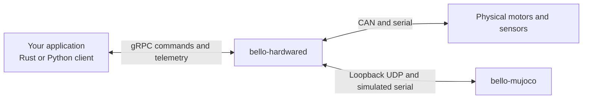

# Bello Stack

Bello Stack lets a Rust or Python application read a robot's sensors and command its motors through one gRPC API. The same application can drive a physical robot or exercise its controller against MuJoCo. The hardware daemon, client libraries, robot descriptions, and simulator live in this repository.

## How the pieces fit together



Your application chooses the motion. The daemon owns the devices, checks commands against the robot's limits, and applies the configured response to faults. Clients can read telemetry without taking control. To command a motor group, such as an arm, a client acquires an exclusive lease for that group. In simulation, MuJoCo advances the physics and returns motor and sensor feedback through the same device interfaces.

For Bello and Bello Mini, the pose estimator combines motor encoders and an IMU to estimate local odometry. MuJoCo can also publish ground-truth pose for comparison and render images from configured cameras.

The [robot descriptions](descriptions) cover Bello, Bello Mini, Mini Torso, and the single- and dual-arm Milly setups. Each pairs a URDF for geometry, joint limits, and transmissions with a hardware description for motors, buses, and control groups. A deployment connects that description to a particular host. For example, Milly's [USB CAN deployment](components/bello-hardwared/config/milly-gsusb.yaml) and [loopback UDP deployment](components/bello-hardwared/config/milly-sim.yaml) both expose the same `arm` group.

## Try it without hardware

From the repository root in the [development environment](docs/development.md#nix-and-direnv), validate the Milly deployment:

```sh
cargo run -p bello-hardwared -- --check --config components/bello-hardwared/config/milly-gsusb.yaml
```

The daemon loads the deployment and its robot description, prints `configuration is valid`, and exits before opening the CAN adapter.

## Where to start

| Goal | Entry point |
| --- | --- |
| Write a controller or telemetry tool | [Python client](components/bello-hardware-python/README.md), [Rust client](components/bello-hardware-client/README.md), and [hardware API](docs/api.md) |
| Bring up a physical robot | [Hardware setup](docs/operations.md#physical-startup), [desktop builds and USB adapters](docs/desktop.md), and [control and safety](docs/control-and-safety.md) |
| Test a controller without a robot | [MuJoCo physics simulation](components/bello-mujoco/README.md) or [Robstride fault injection](components/robstride-emulator/README.md#fault-scenarios) |
| Add or adapt a robot | [Robot descriptions](descriptions) and [configuration reference](docs/configuration.md) |
| Estimate pose or use simulated cameras | [Encoder and IMU pose estimator](components/bello-state-estimatord/README.md) and [MuJoCo camera streams](components/bello-mujoco/README.md#live-camera-streams) |
