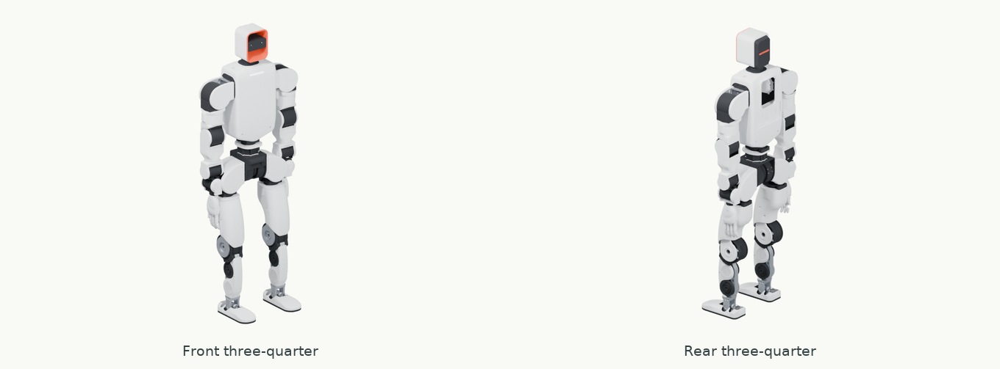
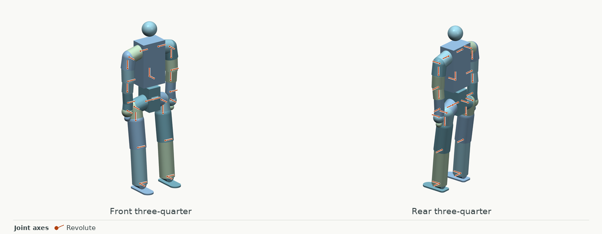

# Bello Mini

Humanoid with a two-axis waist and differential ankle transmissions.

[URDF](urdf/bello_mini.urdf) · [Hardware inventory](hardware.yaml) · [Stereo lens detail](images/stereo-lenses.png)

**Collision geometry and joint axes**

See the [motor topology and calibration notes](motor_topology.yaml) before using the hardware profile.
