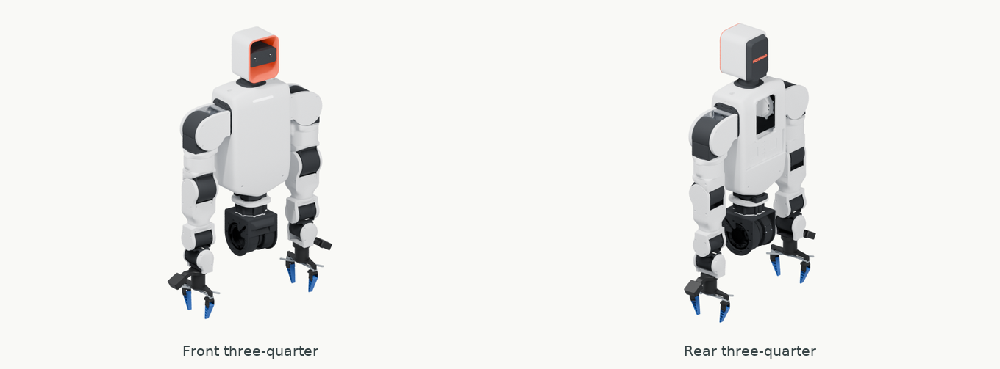
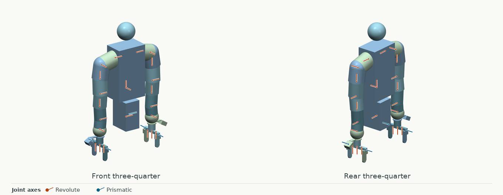

# Bello Mini Torso

Upper-body fixture with a coupled hip drive for torso pitch and a Milly gripper on each arm.

[URDF](urdf/bello_mini_torso.urdf) · [Hardware inventory](hardware.yaml)

**Collision geometry and joint axes**

Verify both hip encoder zeros and load sharing on the installed torso.
