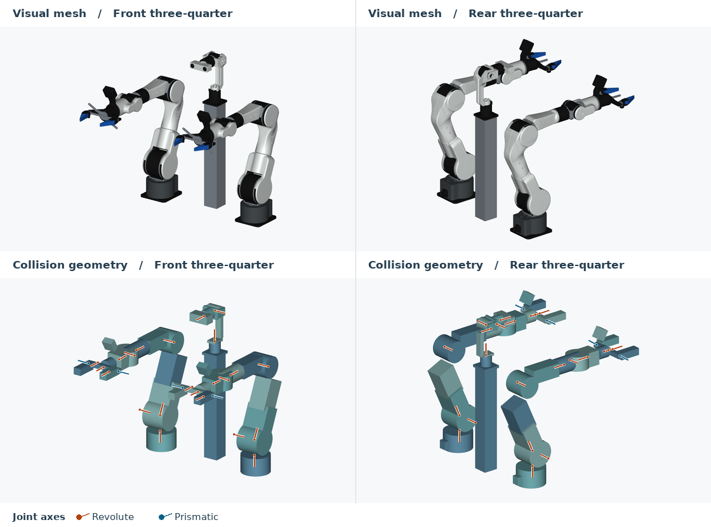

# Dual Milly 7-DOF with stereo gimbal

Two seven-axis arms with parallel grippers and wrist cameras flank a three-axis stereo gimbal. The arm mounts sit 450 mm apart.

[URDF](urdf/milly-7dof-gimbal.urdf) · [Hardware inventory](hardware.yaml)

The [mounting geometry](mounting.json) places the gimbal between the arms. Check [coupled gimbal clearance](../stereo-gimbal/README.md) before using the full joint ranges. The [simulation profile](../../components/bello-sim/README.md#dual-milly-stereo) uses provisional gimbal inertias.
