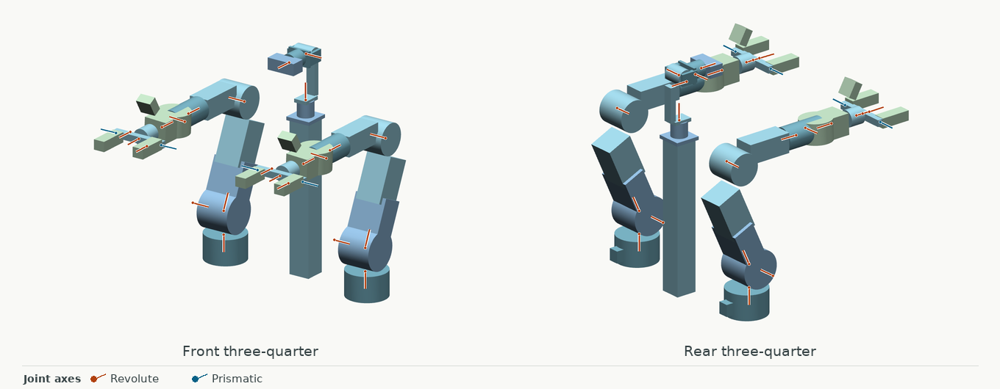

# Dual Milly 7-DOF with stereo gimbal

Two seven-axis arms with parallel grippers and wrist cameras flank a three-axis stereo gimbal. The arm mounts sit 450 mm apart.

[URDF](urdf/milly-7dof-gimbal.urdf) · [Hardware inventory](hardware.yaml)

**Collision geometry and joint axes**

Check [coupled gimbal clearance](../stereo-gimbal/README.md) before using the full joint ranges. The simulator uses provisional gimbal inertias.

[Mounting geometry](mounting.json) · [Stereo simulation](../../components/bello-sim/README.md#dual-milly-stereo)
