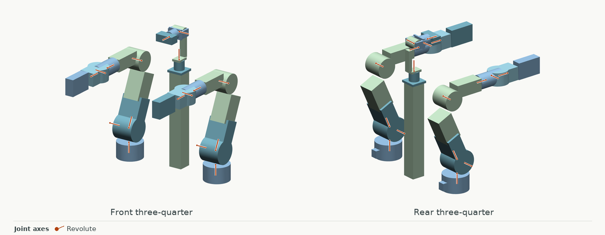

# Dual Milly 7-DOF with Linker O6 hands and stereo gimbal

Two seven-axis arms carry rigid O6 hands. The three-axis gimbal carries the only cameras on this fixture.

[URDF](urdf/milly-7dof-o6-gimbal.urdf) · [Hardware inventory](hardware.yaml)

**Collision geometry and joint axes**

The collision model covers the palms. Check finger travel and cable clearance separately during [commissioning](commissioning.md).

[Hand inventory](hands.yaml) · [Stereo simulator profile](../../components/bello-sim/config/emulator_milly_7dof_o6_gimbal.yaml) · [Matching loopback deployment](../../components/bello-hardwared/config/milly-7dof-o6-gimbal-sim.yaml)
