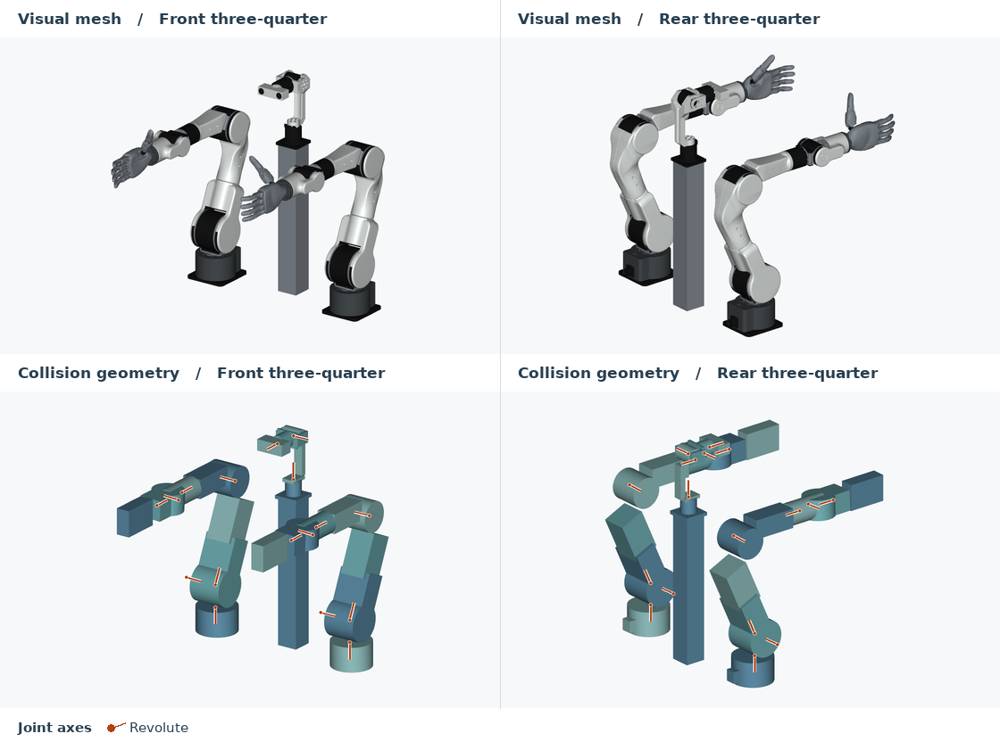

# Dual Milly 7-DOF with Linker O6 hands and stereo gimbal

Two seven-axis arms carry rigid O6 hands. The three-axis gimbal carries the only cameras on this fixture.

[URDF](urdf/milly-7dof-o6-gimbal.urdf) · [Hardware inventory](hardware.yaml)

For simulation, pair the [O6 simulator profile](../../components/bello-sim/config/emulator_milly_7dof_o6_gimbal.yaml) with its [loopback deployment](../../components/bello-hardwared/config/milly-7dof-o6-gimbal-sim.yaml).

Each hand has a palm collision box. Finger travel and cable clearance require a separate check. See the [hand inventory](hands.yaml), [commissioning procedure](commissioning.md), and [stereo simulation](../../components/bello-sim/README.md#dual-milly-stereo).
