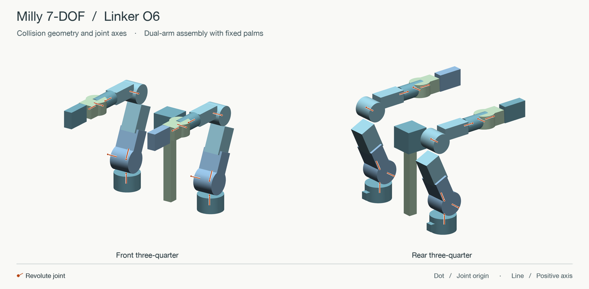

# Dual Milly 7-DOF with Linker O6 hands

Two seven-axis arms carry rigid O6 hands and share a central D405 camera. Use `left_palm_eef` and `right_palm_eef` as tool frames.

[URDF](urdf/milly-7dof-dual-o6.urdf) · [Hardware inventory](hardware.yaml)

**Collision geometry and joint axes**

Each palm has one collision box. The fingers are fixed in the URDF. The [hand inventory](hands.yaml) and [Linux driver](../../components/bello-hand/README.md) describe finger control.

The wrist-to-palm offsets are nominal. See the [palm collision detail](images/palm-collision.png) and the [original palm-frame review pose](images/dual-o6-preview.png).

[Linkerbot mesh source](https://github.com/linker-bot/linkerhand-urdf/tree/49f26021b0a91ff5c33150df22970c07bb548672/O6) · [Mesh license](meshes/LICENSE-Linkerbot)
