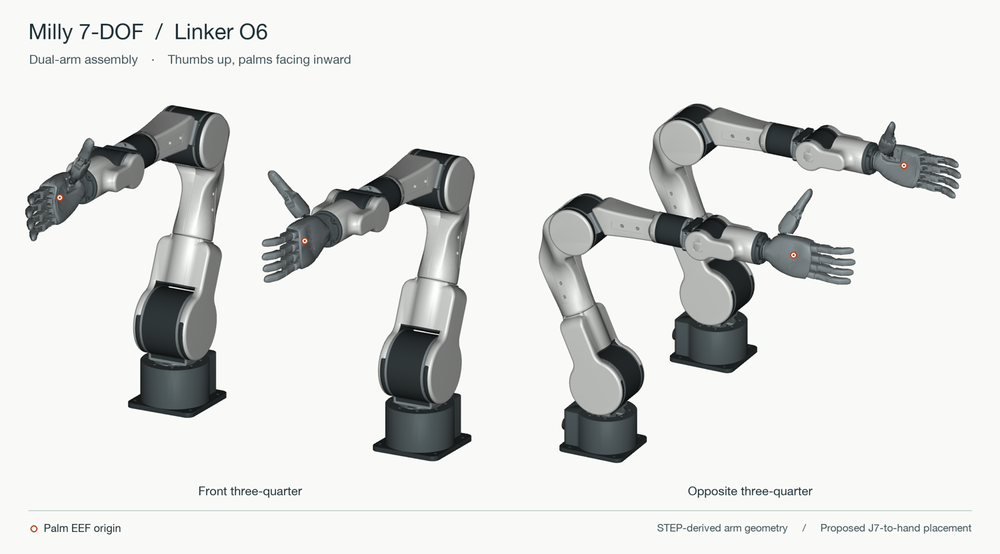
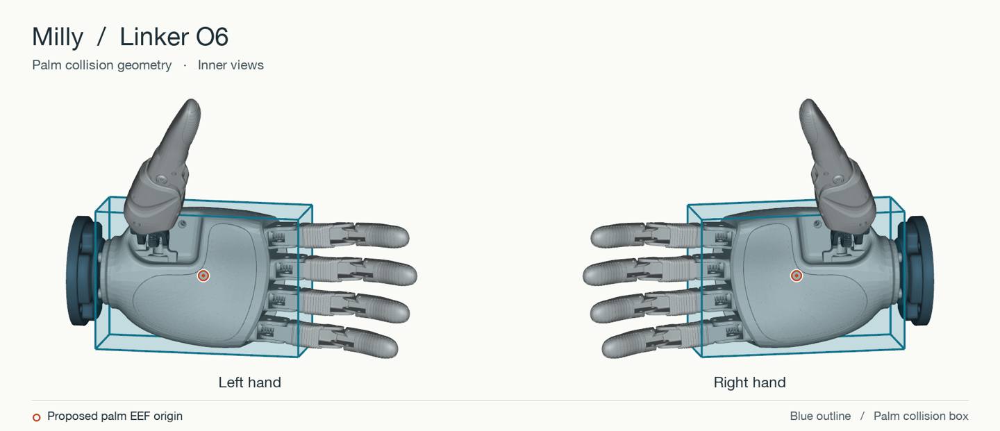

# Dual Milly 7-DOF with Linker O6 hands

Use `left_palm_eef` and `right_palm_eef` as the tool frames for IK and teleoperation. Each hand is a rigid link on the J7 output rotor. The thumb edges point up and the palms face inward in the review pose (J2 and J4 at 1.15 rad on both arms, all other joints at zero). Rolling J7 rotates the corresponding palm.

The `dual_arm` motor group has 14 coordinates, ordered left J1–J7 then right J1–J7. CAN0 serves the left arm and CAN1 serves the right. Each uses IDs 1–7. The O6 fingers have no commanded coordinates, moving joints or collision geometry in this profile. The model omits both wrist cameras and retains the base-mounted center D405 from the dual profile.

For the workcell with head-mounted stereo, use the [dual O6 and gimbal profile](../milly-7dof-o6-gimbal/).

| Entry point | File |
| --- | --- |
| Robot model | [Dual-arm URDF](urdf/milly-7dof-dual-o6.urdf) |
| O6 hand addresses and palm frames | [Hand inventory](hands.yaml) · [Linux hand component](../../components/bello-hand/README.md) |
| Arm motor settings | [Canonical hardware description](hardware.yaml) |
| Hardware daemon | [Physical deployment](../../components/bello-hardwared/config/milly-7dof-dual-o6.yaml) · [vCAN deployment](../../components/bello-hardwared/config/milly-7dof-dual-o6-vcan.yaml) |
| Arm motor emulators | [vcan0](../../components/motor-emulator/config/milly-7dof-dual-o6-can0-vcan.yaml) · [vcan1](../../components/motor-emulator/config/milly-7dof-dual-o6-can1-vcan.yaml) |



## Geometry and calibration

The arm links share the [seven-axis Milly STEP meshes](../milly-7dof/README.md). The J7 plate mesh comes from the supplied J7 NoBolts STEP (SHA-256 `26558be2eb01a460550d2816344d0d6e8f070e7accd5985472b67683bbcd7fca`). It replaces the original output plate in this variant.

The review placement uses 32.194 mm from the J7 rotor origin to the plate seat and 14.5 mm of plate depth. The palm origin lies another 56 mm along the O6 hand's +Z axis toward the fingers. Its +X points out of the palm. The wrist-to-palm offsets and mounting roll are nominal until measured on the assembly.

The left and right [Linkerbot O6 visuals and inertias](https://github.com/linker-bot/linkerhand-urdf/tree/49f26021b0a91ff5c33150df22970c07bb548672/O6) use the vendor's zero joint pose. Visuals were transformed into the hand base frame, simplified and combined by material as metre-scale STL files. The [Apache 2.0 license](meshes/LICENSE-Linkerbot) covers those assets. Each complete hand has the published mass of 0.360 kg. We keep the vendor zero-pose center of mass and scale its combined inertia tensor by 0.360/0.36998, assuming the same mass distribution. The mass includes the fingers. [Linker O6 specifications](https://www.linkerhand.com/details/LinkerHandO6/)

The remaining J7 fixture mass and inertia still need measurement for dynamics work.

Each hand has one palm collision box. Its 40.00 × 76.72 × 112.73 mm dimensions enclose the pinned vendor hand-base visual, rounded outward to 0.01 mm in hand-local X, Y and Z. The box centers are (0, +0.76, 56.365) mm on the left and (0, −0.76, 56.365) mm on the right. Thumb and finger meshes were excluded when fitting the boxes.



## Check the profile

From the repository root on Linux, run the following checks.

```sh
cargo run -p bello-hardwared -- --check --config components/bello-hardwared/config/milly-7dof-dual-o6.yaml
cargo test -p bello-robot-description --test milly_7dof dual_o6_profile_places_rigid_palms_on_each_seventh_axis
```
