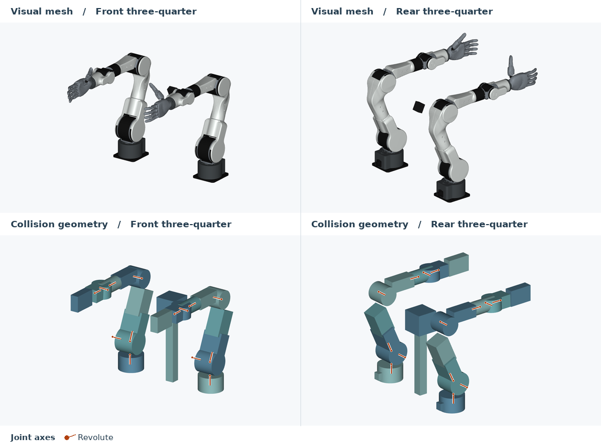

# Dual Milly 7-DOF with Linker O6 hands

Two seven-axis arms carry rigid O6 hands and share a central D405 camera. Use `left_palm_eef` and `right_palm_eef` as tool frames.

[URDF](urdf/milly-7dof-dual-o6.urdf) · [Hardware inventory](hardware.yaml)

The preview shows J2 and J4 at 1.15 rad on both arms, with palms inward and thumbs up. Each hand has one palm collision box. The URDF omits finger motion and finger collisions. Wrist-to-palm offsets are nominal. See the [palm collision detail](images/palm-collision.png), [hand inventory](hands.yaml), and [Linux hand driver](../../components/bello-hand/README.md). The [Linkerbot O6 meshes](https://github.com/linker-bot/linkerhand-urdf/tree/49f26021b0a91ff5c33150df22970c07bb548672/O6) use the [Apache 2.0 license](meshes/LICENSE-Linkerbot).
