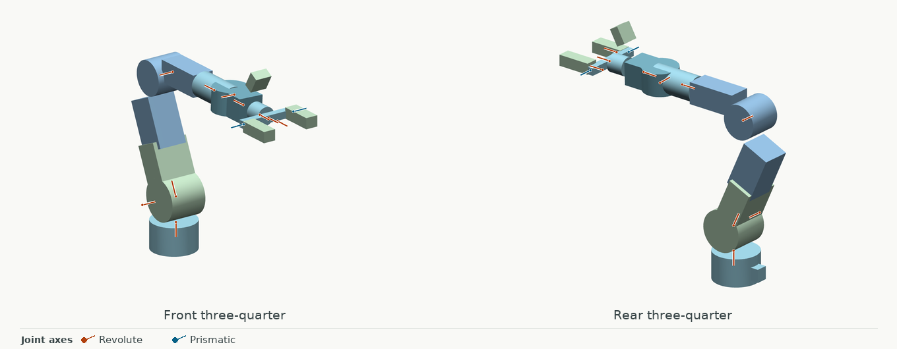
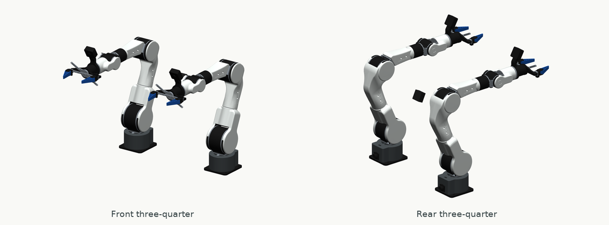
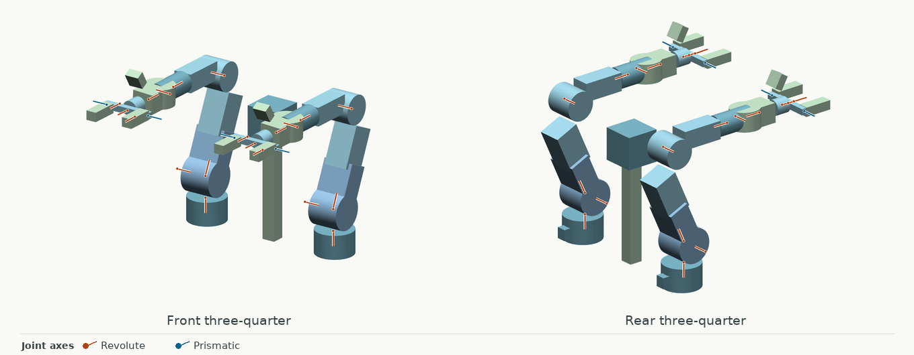

# Milly 7-DOF arms

The single and dual configurations add upper-arm roll at J3. Each wrist carries a parallel gripper and camera.

## Single arm

[URDF](urdf/milly-7dof.urdf) · [Hardware inventory](hardware.yaml)

**Collision geometry and joint axes**

## Dual arms

The dual fixture adds a central D405 camera between the arms.

[URDF](urdf/milly-7dof-dual.urdf) · [Hardware inventory](hardware-dual.yaml)

**Collision geometry and joint axes**

Verify encoder zeros against the [joint limits](sdk-limits.json) before enabling motors.

[Shaft alignment](kinematic-alignment.json) · [Collision geometry](collision-primitives.json) · [Mesh sources](visual-assets.json) · [Inertia sources](physical-parameters.json)
