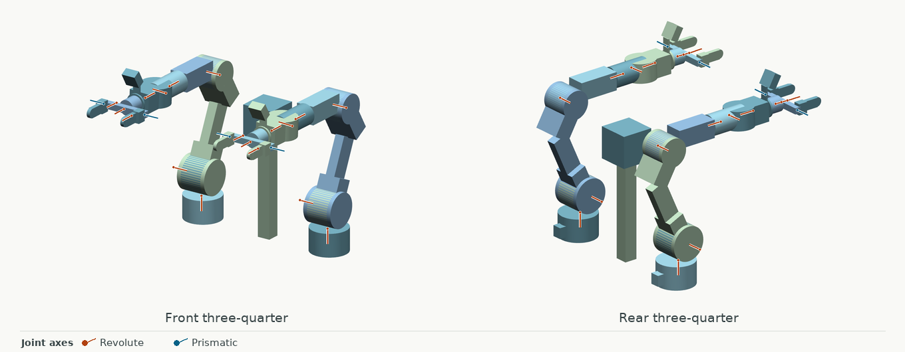

# Dual Milly arms

Two six-axis arms with parallel grippers, wrist cameras, and a central D405 camera.

[URDF](urdf/milly-dual.urdf) · [Hardware inventory](hardware.yaml)

**Collision geometry and joint axes**

