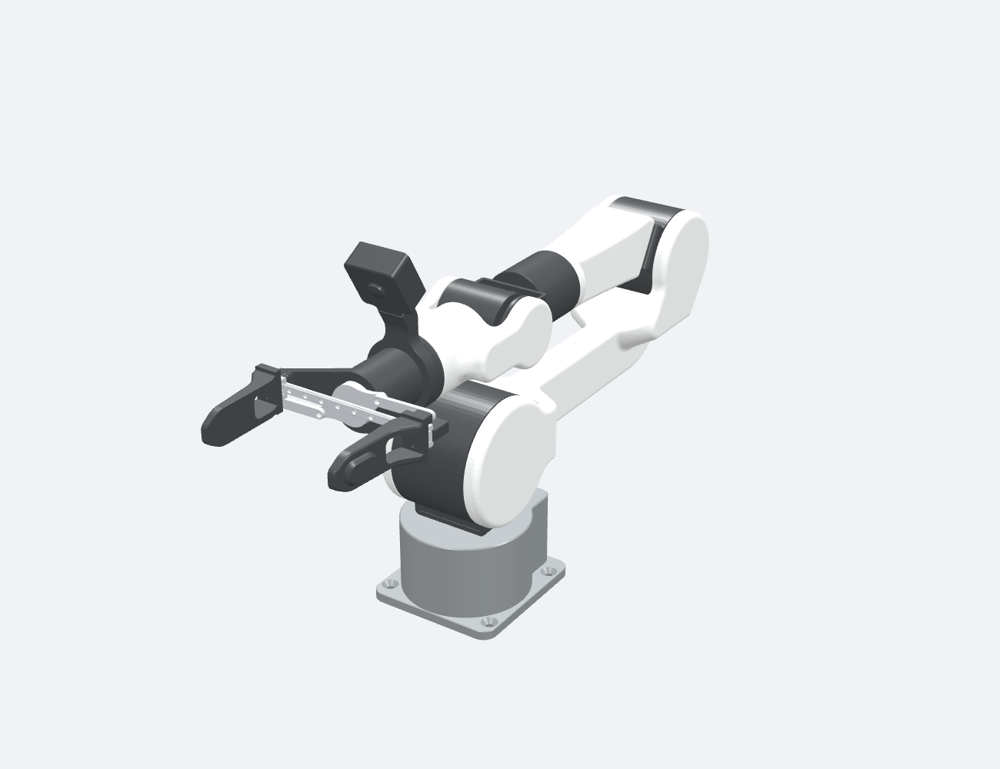
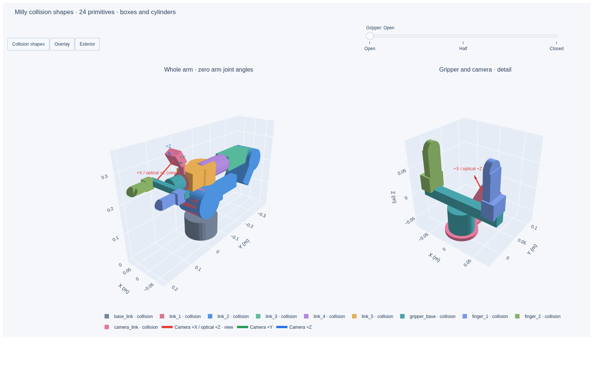
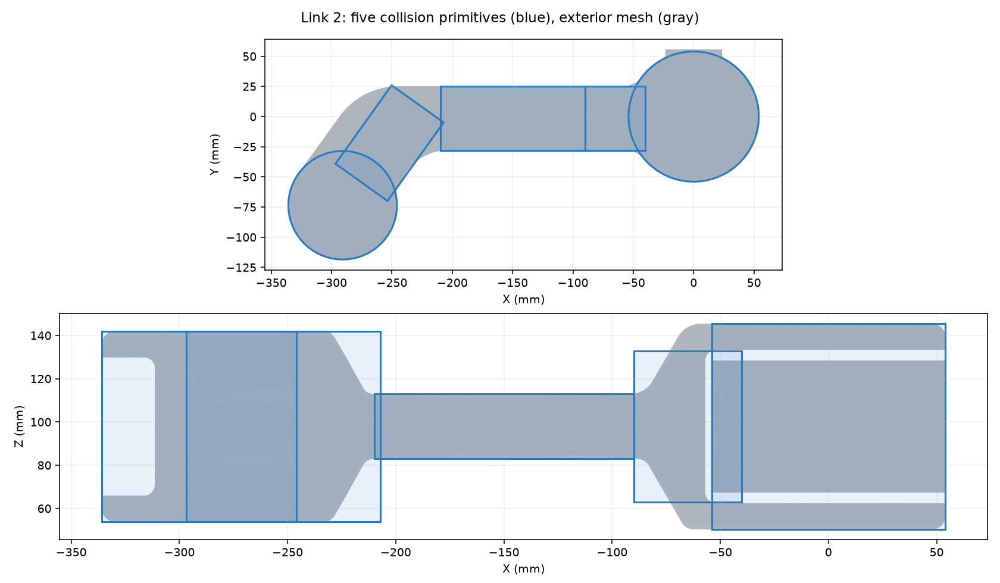
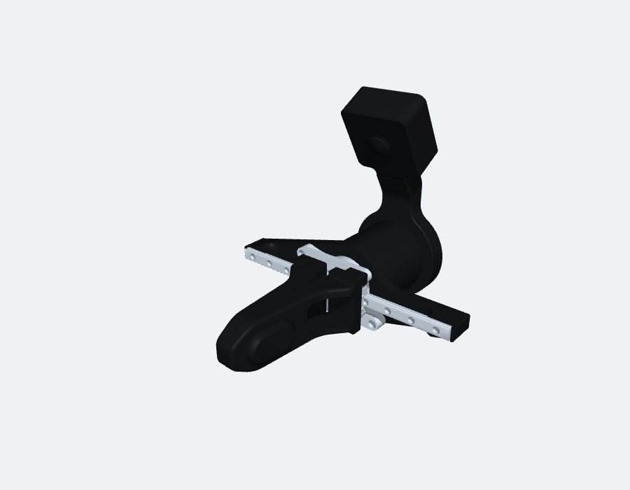

# Milly asset provenance

The Milly arm kinematic origins and original collision meshes were
adapted from `platform/ros2/src/milly_ros/milly_description` at commit
`74d6c46176a91e11564e4cbbf7d183080d7cfb95` of
`MotomindKR/motomind_platform`. The calibrated motor and safety envelopes were
adapted from `configs/robots/motomind_milly/milly_teleop.yaml` at commit
`61292d0b514a09a1623be7cb5f477d0247a70d65` in the same repository.

## SDK mass properties

Mass, center of mass and inertia come from
[`MILLY.urdf` at `4c70a0a84fd27719b70a2395c3d04eeb10053985`](https://github.com/MotomindKR/motomind_platform/blob/4c70a0a84fd27719b70a2395c3d04eeb10053985/platform/python/motomind_milly_sdk/src/motomind_milly/robot/MILLY.urdf).
[`mass-properties.json`](mass-properties.json) records the exact source values,
source hash, SDK visual-to-link transforms and the nominal linkage partition.
Current joint origins, axes, limits, motor signs and hardware control settings
remain unchanged, as requested. SDK raw-angle conventions are not imported.

The SDK meshes and the exterior STEP use the common CAD assembly frame.
The existing `exterior-assets.json` registration and SDK visual origins give
`current_link_from_sdk_link = current_link_from_cad * inverse(sdk_link_from_cad)`.
COM points are transformed with this full rigid transform. Inertia tensors
about the COM are rotated, including the source inertial-frame orientation;
translation does not shift a tensor that remains centered at the COM.

The SDK wrist (`link_6`) combines hardware separated into moving crank/rod
links here. Their existing nominal 15 g / 10 g / 10 g properties are retained
but subtracted from the SDK wrist aggregate using first moments and the
parallel-axis theorem at the CAD reference pose (`gripper = -2.2 rad`).
The residual wrist mass is 0.3562467995254684 kg. Recombining it with those parts
preserves the SDK wrist mass, COM and inertia at that pose. The individual
linkage split remains an estimate. All inertias are positive definite and
satisfy the principal-moment triangle inequalities.

The entire URDF and native simulation total **5.449411285057828 kg**; no extra
35 g is added. The simulation profile no longer supplies additional inertias.
The standalone gripper example reads the canonical URDF's mass properties too.

```sh
uv run --with numpy --with scipy scripts/milly_mass_properties.py
```

The STEP asset generator reapplies the same mass recipe after rebuilding links,
so regeneration cannot restore the former jaw inertias. Native checks validate
the total mass, gripper motion, and arm motion at the existing safety limits.

## Exterior assets

The exterior was updated from the supplied
`Milly_Assem_0914_Case Only.STEP` (SolidWorks 2025, AP214, exported
2026-09-16), using the actual-robot photograph supplied on 2026-10-20 for colors
and visible-part selection. The input SHA-256 is
`9ce92b12ed36bbb7daf16116596f757f20f34a90085ee3a43f3fe9b6506be7dc`.

The 139 old gray visual meshes are replaced by 20 meshes with off-white cases,
black joint covers and gripper components, a gray base, and silver linkage and
rail surfaces. The black shoulder/elbow covers are labeled as spacers in the
CAD; they remain because they form visible exterior surfaces. Covered mounting
plates, internal bearings, electronics, screws and internal limit hardware are
omitted. Cables and decals absent from the CAD were not synthesized.

The STEP's ribbed fingers differ from the rounded jaws in the photograph.
The two original rounded jaw assemblies and the visible base connector are
retained byte-for-byte under `meshes/visual/retained`. The jaws now translate
on the rail. Their SDK mass properties are expressed in the new slider
frames using the common CAD registration. All other exterior meshes are tessellated from 27 STEP instances
at 0.10 mm linear / 0.15 rad angular deflection and converted from mm to m.

[`exterior-assets.json`](exterior-assets.json) records the instance paths,
omissions, materials, mesh hashes for retained parts, and CAD-to-link matrices.
Meshes use the existing arm link frames; the six arm joint origins and limits
are preserved. Collision geometry now uses the approximate primitive shapes
listed below; the original convex-hull STL colliders have been removed.



Regenerate using the separately supplied proprietary STEP:

```sh
uv run --python 3.12 --with cadquery==2.8.0 --with trimesh==5.1.1 --with scipy \
  scripts/update-milly-assets.py --step '/path/Milly_Assem_0914_Case Only.STEP'
```

## Primitive collision shapes



[`collision-primitives.json`](collision-primitives.json) defines 24 boxes and
cylinders in the existing URDF link frames, in metres and radians. Rounded motor
housings use cylinders; long covers use boxes. Link 2 uses separate shoulder,
straight neck and bent elbow shapes: its long central beam is 30 mm thick,
matching mesh cross-sections, rather than the former diagonal 88 mm box.
Link 2 uses five primitives, with one box per neck/bridge transition.
The gripper body uses a motor cylinder and one rail assembly box. Each moving
jaw uses three shapes: a base box, a flat gripping face and a cylindrical
rounded tip. Small carriage/neck steps are merged into the jaw base. Only the crank and connecting rods have no
collision geometry; their visual geometry and kinematic links remain intact.
The camera housing, stalk and mount retain separate shapes. Small holes, jaw
cutouts and fine surface details are omitted; these shapes are neither exact
CAD surfaces nor guaranteed enclosing volumes.



`python scripts/milly_collisions.py` applies the recipe to the URDF. The STEP
asset generator calls the same function so regeneration preserves the primitive
colliders. This changes only collision geometry: visual meshes, joint frames,
mass properties and limits are preserved. The standalone gripper demo reads the canonical
inertias independently of the collision approximation.

Generate an offline, interactive whole-arm and gripper view with exterior overlay
and open/half/closed gripper positions:

```sh
uv run --with numpy --with scipy --with trimesh --with fast-simplification \
  --with plotly scripts/milly_collisions.py --preview /tmp/milly-collisions.html
open /tmp/milly-collisions.html
```

The preview uses zero arm joint angles and does not command the running robot.
Labeled camera axes mark +X forward (red), +Y left (green), and +Z up (blue).
The longer red arrow is also optical-frame +Z, the viewing direction.
MuJoCo checks the normal -2.2 to 0 rad gripper sweep at zero and bent arm poses
without the previous four rod/carriage exclusions. Crank and rod collision
surfaces are omitted entirely. Parent/near-neighbor exclusions retain their
existing policy. Full-arm contact-free motion is not guaranteed at every
configuration.

## Gripper linkage

The `gripper` motor turns a crank with two opposite pins. Each 45 mm rod joins
a 30 mm crank pin to a slider pin 14 mm above/below the crank centreline.
`finger_1_joint` and `finger_2_joint` are prismatic joints with opposite outward
axes. The two `gripper_rod_*_joint` hinges move the connecting rods. The old
virtual joint that rotated both jaws as one rigid assembly has been removed.

URDF represents the spanning tree. The namespaced `bello:slider_crank` element
declares the four passive joints and the dimensions measured from STEP cylinder
axes. `bello-robot-description` computes their positions and velocities, and
`bello-visualizer` applies them after reconstructing motor feedback. There are
still exactly seven motor coordinates; the four passive joints cannot be used
as independent motor coordinates.

For motor angle `q`, crank angle `theta = q + phase`, radius `r`, rod length `L`
and slider offset `h`, the outward assembly branch is:

```text
v = h - r sin(theta)
d = sqrt(L² - v²)
s = r cos(theta) + d
beta = atan2(v, d)
slider position = s - slider_reference
rod hinge angle = beta - theta
```

The second side uses the same scalar joint values with mirrored joint frames.
The `gripper_rod_*_tip` and `finger_*_pin` frames coincide when the loop closes.
The solver is tested through the entire `[-2.4, 0.1]` rad envelope, including
finite-difference velocity checks and end-to-end FK closure.

The CAD pose has crank angle 0.449009773783 rad. Assigning the legacy bridge's
open motor position `-2.2` rad to that pose gives phase 2.649009773783 rad.
This is an **encoder-phase assumption**, not a physical calibration. The
operational closed endpoint remains `0` rad. Confirm the encoder phase on the
robot before treating the displayed jaw opening as a measurement; then update
the generator's `OPEN_MOTOR` and regenerate both formats.

Generic URDF tools ignore the custom element. They must receive all five
gripper joint positions from the closure solver. A linear `<mimic>` relation
cannot express the rotary-to-slider geometry exactly; see the
[urdfdom discussion of nonlinear mimic relationships](https://github.com/ros/urdfdom/issues/132).

## Native loop constraints

[`mjcf/gripper.xml`](mjcf/gripper.xml) is a standalone MuJoCo mechanism example
with one actuator and two native `connect` equality constraints joining the
rod-tip and slider-pin sites. The four passive joints are solved by MuJoCo.
It includes open/closed keyframes and the camera. This uses MuJoCo's documented
[site-to-site connect constraints](https://mujoco.readthedocs.io/en/stable/XMLreference.html#equality-connect).



```sh
uv run --python 3.12 --with numpy --with scipy --with trimesh --with mujoco==3.16.0 \
  scripts/export-milly-gripper.py --check
```

Add `--with pillow` to the `uv run` dependencies and `--preview` to the script
arguments to regenerate the motion GIF with an OpenGL renderer (EGL on Linux).

The check covers 101 analytic poses and 6000 driven simulation steps. This
example uses the canonical URDF inertias, no gravity and no contact forces to
demonstrate loop closure. It is not a calibrated full-arm dynamics model or a
`bello-mujoco` hardware deployment. The newly separated crank/rod inertias and
contact model need physical characterization for that use.

## Camera frames

`camera_mount` fixes `camera_link` directly to `link_6`, independently of the
gripper motor. Its origin is the nominal lens centre measured from the STEP:
`(0, -166.7094, 314.8766)` mm in CAD coordinates. The forward cylinder axis is
`(0, -sqrt(3)/2, -1/2)` in those coordinates.

`camera_link` uses X forward, Y left, Z up. Its fixed child
`camera_optical_frame` uses Z forward, X right, Y down. Tests verify the nominal
lens position/direction and that opening the gripper does not move the camera.
The mesh includes the bracket and housing, so no additional visual copy is
attached to the optical frame. Optical centre, extrinsics and intrinsics are
nominal until calibrated; the MJCF camera's 60-degree field of view is only a
preview setting.

## Rights

The descriptions and meshes are proprietary. This repository does not grant
permission to redistribute them. External distribution requires a separate
written agreement with the applicable rights holder.
