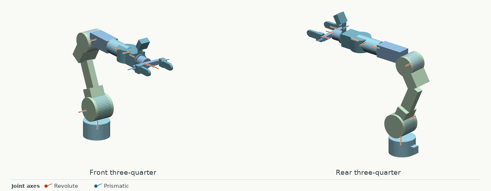
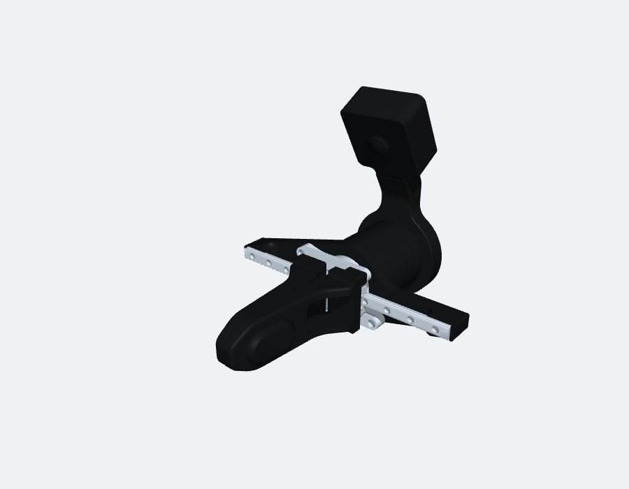

# Milly arm

Six-axis arm with a wrist camera and a parallel gripper. Its carriages, finger mounts, and blue pads are shared with the [seven-axis arm](../milly-7dof/README.md#single-arm).

[URDF](urdf/milly.urdf) · [Hardware inventory](hardware.yaml)

**Collision geometry and joint axes**

Gripper linkage in motion

