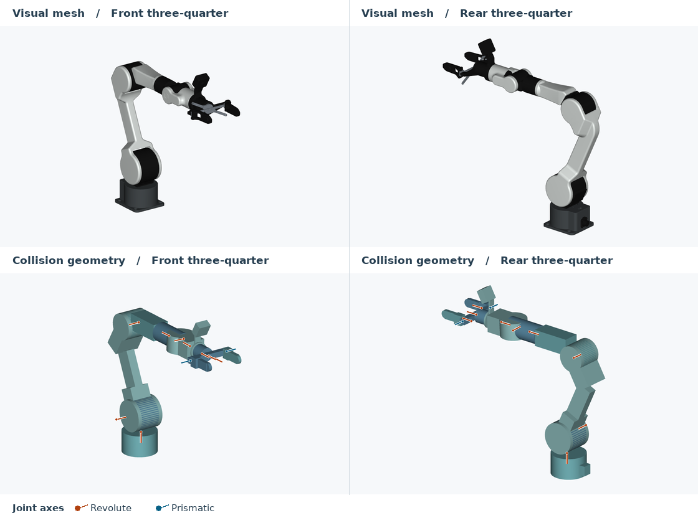

# Milly arm

Six-axis arm with a parallel gripper and wrist camera.

[URDF](urdf/milly.urdf) · [Hardware inventory](hardware.yaml)

The [gripper motion detail](images/gripper-motion.gif) shows the finger linkage.
