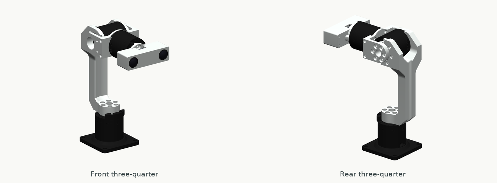
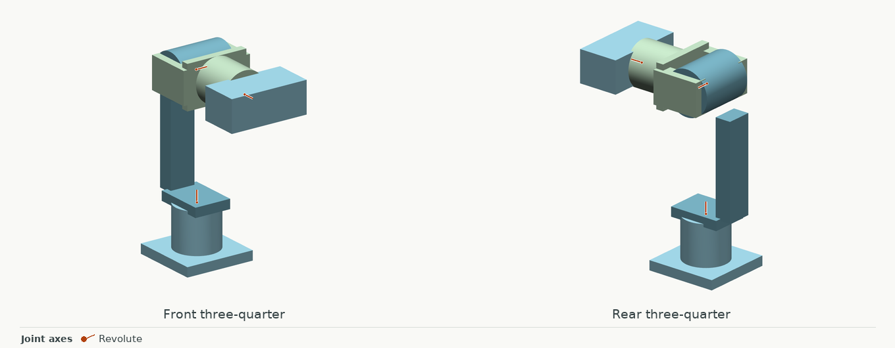
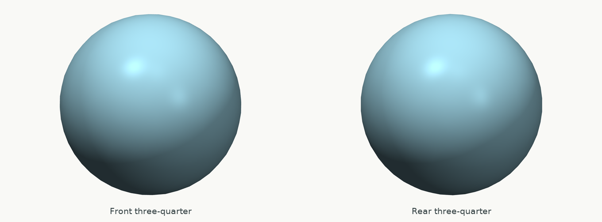

# Stereo camera gimbal

Three joints drive yaw, pitch, and roll. At zero the mounting frame points X forward, Y left, and Z up.

[URDF](urdf/stereo-gimbal.urdf) · [Hardware inventory](hardware.yaml)

**Collision geometry and joint axes**

The camera housing intersects the rear yaw support at pitch +90° combined with roll ±90°. Check [coupled clearance](clearance-check.json) and cable travel on the installed assembly.

## Collision envelope

The optional 132 mm radius sphere encloses the moving gimbal. Keep the fixed base, yaw stator, and support collisions when using it. This proxy has no visual geometry or movable joints.

[Proxy URDF](urdf/gimbal-safety-envelope.urdf) · [Envelope definition](safety-envelope.json) · [Detailed collisions](collision-primitives.json)

